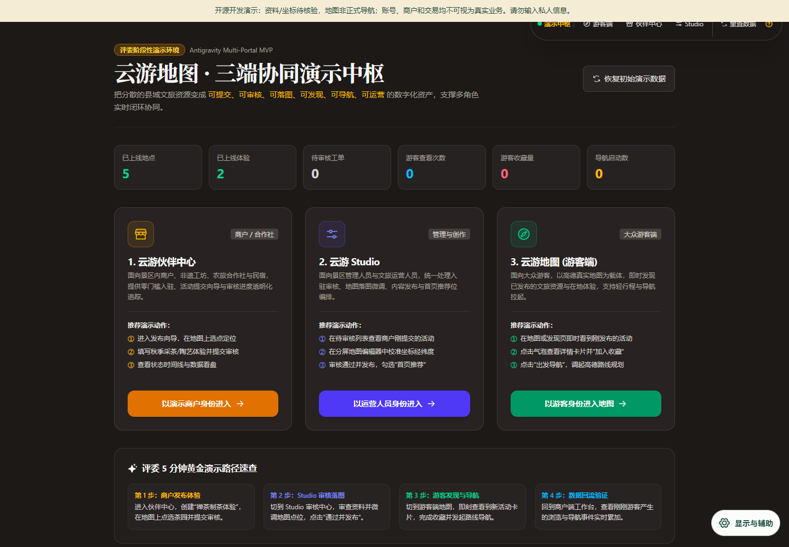

# 六祖云游 · 游客 / 商户 / 运营三端开发线

与主版独立保留的三端原型，增加游客浏览、演示商户内容提交及运营审核等源码。演示身份和业务数据存于当前浏览器 LocalStorage，能被本机使用者修改，**不具备生产认证或权限隔离能力**。没有真实商户、联系人、手机号、收款账户或支付能力。



商户退回修改后的重新提交修正为独立状态转换，新增测试覆盖组织归属、角色约束、持久化和不可变历史。刷新时按本机演示角色初始化界面，避免初始渲染不一致。

[项目家族与两条开发线说明](docs/project-family.md) · [第三方许可](THIRD_PARTY_NOTICES.md)

## 快速上手

需要 Node.js 24 LTS 与 npm，以下命令在仓库根目录执行。首次安装需要网络；npm ci 安装锁定依赖，并从同一 MapLibre 包同步其浏览器运行文件。

```sh
npm ci
npm run dev -- --hostname 127.0.0.1
```

打开终端显示的本机地址。默认无需环境文件、模型密钥或供应商地图密钥。生产模式本机运行：

```sh
npm run build
npm run start -- --hostname 127.0.0.1
```

无密钥时使用本地资料、候选行程及受边界约束的本地导览；无 PostgreSQL/PostGIS 时依赖该存储的接口会明确不可用，地图可回退到随包公开资料。真实账号、跨设备同步、生产分享权限、正式导航及远程模型不能用本机演示结果代替验收。

如需研究后端，复制 .env.example 为 .env.local，按实际源代码配置 PostgreSQL/PostGIS 和相应服务。npm run db:migrate 会写入所配置数据库，请只对专用开发库执行；npm run test:db 也需要独立测试库。远程 Gemini 需要真实 GEMINI_API_KEY、模型以及合规/质量/持续限流等门禁；仅填写一个 Key 不会使全部功能自动可用。供应商账号、密钥、真实用户数据与数据库转储应始终保留在仓库外。

## 在线静态体验

[打开 GitHub Pages](https://yangwei251003.github.io/liuzu-cloud-map/) 展示真实 personal-route-builder.ts 的浏览器构建：按时长、节奏、同行人和兴趣生成**本机候选行程**，并浏览实际应用截图。页面不调用后端、数据库、模型或地图供应商，也不保存输入。它不提供实时道路、营业状态、订票、支付或正式导航；请以现场标识和管理方公告为准。

```sh
npm run build:preview
node scripts/check-static-preview.mjs
```

preview-dist 是生成的静态成品，可用静态服务器预览。最后一条命令需要本机已安装 Google Chrome；它启动隔离的无头窗口，验证仓库子路径、36 种偏好组合、断网使用、刷新和手机宽度。GitHub 工作流只在 main 分支部署静态成品，**不会把 Next.js API 部署到 Pages**。

## 技术与目录

- TypeScript、Next.js 16、React 19、PostgreSQL/PostGIS 适配、MapLibre、PMTiles、Framer Motion；三端开发线另有 Leaflet 适配。
- src/app 页面/API；src/components 界面；src/lib 领域与服务边界；database 数据库迁移。
- public/data/gis 公开 OSM 派生资料；public/assets 经筛选的图像和运行资源。
- tests 单元/合同测试，tests/e2e 浏览器场景；preview 仅静态交互入口。
- mobile/android-web-shell Android WebView 壳；iOS 仅方案文档，没有可构建的 Xcode 工程。
- tools 可选 GIS 生成器；docs/provenance 资产来源、许可与不随包文件索引。

```sh
npm test
npm run typecheck
npm run lint
npm run build
```

现有浏览器测试中的账号、语音和分享使用隔离演示或测试替身，不代表真实认证/语音供应商/生产数据库通过。范围与限制见 [验证记录](docs/release-validation.md)。

## Android 与可选 GIS 工具

Android 壳需要 Android SDK 35、Build Tools 35、JDK 17 或 21 与 Gradle 8.9。已用本机现有 JBR 21、SDK 和独立缓存离线编译 debug 包，编译参数使用保留的无效示例域名；未安装真机、未验证位置权限/后台导航，不附带 APK、签名文件或 SDK。Java 25 不兼容这套 Gradle 配置。实际应用必须另行核验网页 HTTPS 地址与安全策略；命令见 mobile/android-web-shell/README.md。

GIS 生成工具需要 Python 3 与 tools/requirements.txt，仅用于获授权的公开 OSM 导出：先看 tools/README.md。输出默认落入忽略的 .local/。原型道路连线带开发警告，不构成管理方核验的正式路线。

## 许可、安全与项目状态

自有代码与文档采用 MIT。第三方照片、OSM 数据、字体和依赖保留各自许可及署名，详见 [第三方声明](THIRD_PARTY_NOTICES.md)。AI 图为概念示意，不能当作实景或测绘数据；无授权品牌/IP/视频/商业字体不随包。

项目处于**开发中**。本轮保留本地未提交的有效业务增量，修补兼容依赖与必要演示问题，补充公开静态入口。正式道路核验、生产账户/数据库验收、真实设备与无障碍完善仍待完成。更新见 [CHANGELOG](CHANGELOG.md)。原件仍包含未归档的私人配置、来源素材及开发证据，当前**不可据此删除本地原项目**。
