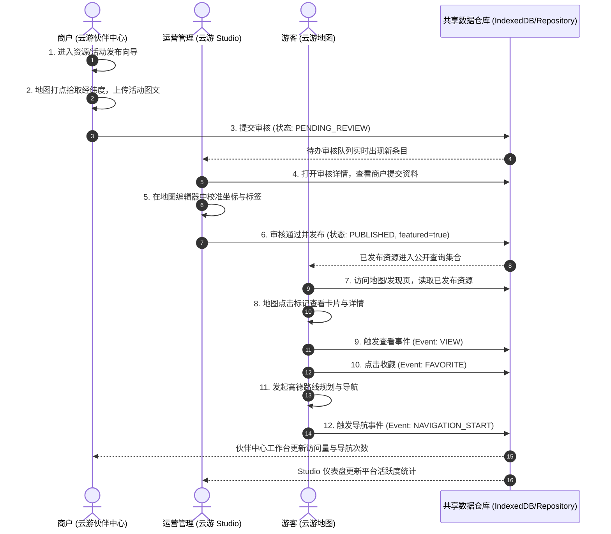

# 跨端协同旅程与状态流转设计

## 1. 跨端角色时序图 (Mermaid)



---

## 2. 核心状态机流转规则

```text
       [草稿 DRAFT]
            │
            ▼ (提交审核)
   [待审核 PENDING_REVIEW]
      │                 │
      │ (要求修改)      │ (审核通过)
      ▼                 ▼
[需修改 CHANGES_REQ] [已通过 APPROVED]
      │                 │
      ▼ (重新提交)      ▼ (发布上线)
   [待审核]       [已发布 PUBLISHED]
                        │
                        ▼ (下架)
                  [已下架 UNPUBLISHED]
```

### 状态转移权限表
| 初始状态 | 目标状态 | 触发动作 | 允许角色 | 前置条件 |
| :--- | :--- | :--- | :--- | :--- |
| `DRAFT` | `PENDING_REVIEW` | 提交审核 | `partner` | 必填字段齐全、地图经纬度有效 |
| `PENDING_REVIEW` | `CHANGES_REQUESTED` | 要求修改 | `studio` | 必须附带退回原因说明 (`reviewNote`) |
| `CHANGES_REQUESTED` | `PENDING_REVIEW` | 重新提交 | `partner` | 修改内容已更新 |
| `PENDING_REVIEW` | `APPROVED` | 审核通过 | `studio` | 资料合规、点位校准无误 |
| `APPROVED` | `PUBLISHED` | 发布上线 | `studio` | 确认公开可见性 |
| `PUBLISHED` | `UNPUBLISHED` | 下架撤回 | `studio` | 填写下架原因 |
| `PENDING_REVIEW` | `REJECTED` | 拒绝入驻 | `studio` | 必须附带拒绝原因 |
